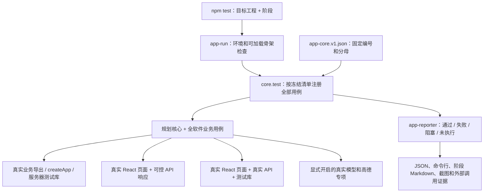

# 旅行规划助手：全软件 TDD 测试

本目录是整个软件的测试工程，覆盖 A 的用户界面、B 的地点与推荐、C 的认证与行程、D 的到访/足迹/手账/图片，以及它们之间的协作流程。

编写日期：2026-11-18。**状态：测试代码已编写，尚未执行。** 本次仅进行静态语法、文件引用和清单一致性检查，没有启动 API、浏览器、数据库、SSH、模型或地图调用，没有新的通过率或截图。下文命令供后续获准运行时使用。

课程要求采用“先测试，再实现，再重构”：从有效业务失败基线开始，逐阶段修改软件实现，让同一套测试逐步通过。**0% 和 100% 是目标，必须用真实执行记录证明。** 已有软件实现不会自动变成初始 0%，环境损坏或跳过不能冒充业务失败。

## 1. 从哪里开始看

- [测试计划](测试计划.md)：测试范围、方法、T0—T10 开发安排和完成标准。
- [测试接入约定](docs/测试接入约定.md)：页面定位标识、文件存储和认证过期等测试配置约定。
- [需求覆盖矩阵](docs/需求覆盖矩阵.md)：各模块与原 I01— I18 如何落到实际用例。
- [全软件冻结清单](cases/app-core.v1.json)：全部编号、标题、方法、依赖、阶段和文件。
- `docs/依据/`：编写测试时采用的 v1.1 接口契约及 A/C/D 开发说明快照；其中历史相对引用保留原文。

原有 100 个规划核心用例继续参与总集合。旧的 B 专项说明和计划保存在 `B核心测试说明.md`、`B核心测试计划.md`，其命令仅供历史参考，当前全软件入口以本文为准。

## 2. 测试代码架构

```text
App_Test/
├── README.md                         # 本文：架构、配置、测试和报告
├── 测试计划.md                       # 全软件 TDD 计划
├── package.json / package-lock.json   # 独立测试依赖与固定安装版本
├── .env.example / .gitignore          # 配置模板；忽略密钥和生成报告
├── cases/
│   ├── app-core.v1.json               # 全软件 222 项冻结清单
│   ├── tdd-core.v1.json               # 原 100 项规划子集清单
│   └── image-fixtures.json            # 合成且可解码的 PNG/JPEG/WebP
├── tests/
│   ├── tdd/                          # 规划、地图、模型和方案的 100 项核心测试
│   └── app/
│       ├── core.test.cjs              # 全集合唯一注册入口
│       ├── auth.cases.cjs             # 真实注册、登录、令牌与资料
│       ├── trips.cases.cjs            # 草稿、版本、确认、重置与事务
│       ├── visits.cases.cjs           # 真实到访和城市归属
│       ├── footprints.cases.cjs       # 聚合、年份过滤和点亮生命周期
│       ├── journals.cases.cjs         # 随笔 CRUD、文本与归属
│       ├── media.cases.cjs            # 文件上传、签名、大小、关联与补偿
│       ├── security.cases.cjs         # 权限、SQL 输入、错误脱敏和 CORS
│       ├── database.cases.cjs         # 完整迁移、升级、重启与并发
│       ├── ui.cases.cjs               # 真实页面 + 可控接口的交互测试
│       ├── e2e.cases.cjs              # 真实页面 + 真实 API/数据库的两条流程
│       ├── external.cases.cjs         # 真实模型 prompt/回复和真实高德
│       └── support/
│           ├── world.cjs             # 实际 createApp、真实注册、资源和数据库隔离
│           └── browser.cjs           # Vite、Playwright、UI 固定响应和截图
├── scripts/
│   ├── app-run.cjs                    # 全软件执行入口、环境检查和证据保存
│   ├── app-reporter.cjs               # 全集合固定分母统计
│   ├── static-check.cjs               # 只检查语法和声明，不执行测试
│   └── tdd-*.cjs                     # 保留的规划专项入口
└── reports/app/                       # 实际运行后才生成
```



测试使用 Node.js 内置 `node:test` 和 `assert`；浏览器使用 Playwright。目标工程通过绝对路径加载，不自动选取 `.subject` 或已经实现的旧分支。测试工程没有业务实现，也不会生成假的 Auth、Trip 或 Journal 来满足断言。

`tests/app/support/world.cjs` 调用目标工程真实 `createApp`，使用随机本机端口。全软件用例经真实注册/登录取得令牌；规划子集中的身份替身只用于该子集的隔离装配。

UI01— UI20 使用固定 API 响应检查真实页面行为；这些响应只是 UI 的依赖替身。E2E01— E2E04 将浏览器请求转交真实应用并原样返回响应，验证真实认证、数据库保存、图片读取和刷新恢复，不用模拟接口冒充端到端通过。

## 3. 测试范围与数量

| 范围                                   | 编号                     |    数量 | 主要方法                                                |
| -------------------------------------- | ------------------------ | ------: | ------------------------------------------------------- |
| 地点、输入、排程、方案、地图和模型适配 | V/C/P/S/R/G/M/H          |     100 | 单元、边界、性质、真实 SQL、实际适配器与可控 HTTP       |
| 注册登录、资料、令牌到期               | A01— A13                 |      13 | 真实 HTTP、并发注册、数据库密码检查、短有效期           |
| 草稿、版本、方案确认和正式日程         | T01— T24                 |      24 | 状态迁移、并发、故障注入与真实事务                      |
| 到访记录                               | D01— D10                 |      10 | CRUD、日期/坐标边界、跨用户权限                         |
| 足迹与城市点亮                         | F01— F08                 |       8 | 同集合聚合、组合过滤、删除生命周期                      |
| 图文随笔                               | J01— J10                 |      10 | CRUD、文本契约、权限与失败回滚                          |
| 图片                                   | U01— U15                 |      15 | 实际图片、10 MiB 边界、9 张限制、关联竞争与补偿         |
| 公共安全                               | SEC01— SEC08             |       8 | 身份矩阵、SQL 输入、脱敏与 CORS                         |
| 全软件数据库与重启                     | DB01— DB05               |       5 | 完整迁移、基础库升级、真实应用重启和并发提交            |
| 页面交互与异常                         | UI01— UI20               |      20 | 浏览器操作、可控响应、手机与电脑布局                    |
| 两条真实主流程                         | E2E01— E2E04             |       4 | 390/1280 宽度，真实页面/API/数据库/文件                 |
| 正式外部服务                           | EX01— EX05               |       5 | 真实模型 prompt→回复→校验/方案；真实高德路线/逆地理/GPS |
| **合计**                               | **固定集合 app-core.v1** | **222** | 每个逻辑编号只计一次                                    |

其中 118 项需要服务器专用 PostgreSQL 测试库，24 项需要浏览器（20 项 UI + 4 项真实端到端），5 项需要显式启用真实外部服务。单个用例内的多组输入和多个断言不额外增加分母。

## 4. 执行前准备

这些步骤本次没有执行。

1. Node.js 至少 22.12.0；准备目标工程的依赖与可构建接口骨架。
2. 测试数据库继续使用服务器 Docker 中的 PostgreSQL。本机只运行测试客户端、临时 API、Vite 和浏览器。
3. `TEST_DATABASE_URL` 指向已经存在的专用 `_test` 数据库；账号须有创建 schema 和执行迁移权限。
4. 浏览器默认在 Windows 使用已安装的 Edge；其他平台可安装 Playwright Chromium。缺少浏览器属于环境阻塞。
5. 按[测试接入约定](docs/测试接入约定.md)接入页面标识、隔离文件目录和短令牌有效期；缺少业务接口/页面应产生真实失败。

先安装测试依赖，再在**目标工程**安装依赖并构建 API：

```powershell
Set-Location F:\TPA\Test_coding\App_Test
npm ci

# 改为实际 TDD 教学工程；当前并未替你创建该教学版本。
$env:TPA_APP_SUBJECT_ROOT = 'F:\TPA\独立TDD工程\travel-planner-v2-framework'
Set-Location $env:TPA_APP_SUBJECT_ROOT
npm ci
npm run build --workspace=@travel/api
```

Windows 默认浏览器渠道为 `msedge`。若使用 Playwright 自带 Chromium，在测试目录执行 `npx playwright install chromium`，并将 `TPA_BROWSER_CHANNEL` 设为空字符串。运行器会自动启动和关闭随机端口的 API/Vite；不用手动运行前端、API 或全局迁移命令。每次业务代码修改后，应重新构建 API，否则可能仍测试旧的 `dist`。

## 5. 配置数据库、模型与地图

若仍使用此前服务器端口，在独立终端开启隧道并保持运行：

```powershell
ssh -N -o ExitOnForwardFailure=yes -o ServerAliveInterval=30 -o ServerAliveCountMax=3 -L 127.0.0.1:55432:127.0.0.1:55432 -L 127.0.0.1:11434:127.0.0.1:11434 -p 22 ubuntu@120.53.94.209
```

按 SSH 提示认证；文档和代码不保存服务器密码。端口变更时同步调整配置。

```powershell
Set-Location F:\TPA\Test_coding\App_Test
Copy-Item .env.example .env
# 用编辑器填写实际测试库连接；完整外部专项还要填写/开启模型和地图配置。
$env:TPA_APP_ENV_FILE = (Resolve-Path .env).Path
```

模板提供服务器 PostgreSQL、Ollama 兼容地址和显式开关。模型可使用此前的 `qwen2.5:0.5b`，是否满足严格结构化输出要由 EX01 实测；不支持该能力会如实失败，不将回退算成真实模型有效输出通过。

`.env` 中默认 `TPA_APP_REAL_MODEL=0`、`TPA_APP_REAL_AMAP=0`。普通业务装配强制关闭真实地图/模型，适配器子集使用本地可控服务；只有 EX 专项读取真实配置。完整 222/222 必须显式开启真实专项并满足全部依赖，缺 Key/服务时会记阻塞，不会宣称全软件完成。

入口只从私有文件读取测试库、模型、地图、真实调用开关及浏览器渠道的白名单变量；系统环境变量优先。目标路径仍单独通过 `TPA_APP_SUBJECT_ROOT` 或 `--subject` 指定。

每个真库用例创建自己的随机 schema，结束时先关闭应用连接池再删除自己的 schema。全软件应用不会回落查询 `public` 中同名业务表。文件写入独立临时目录，用例结束后清理；强制杀死进程可能留下本次临时资源。

## 6. 如何测试与推进 TDD

本次只编写，以下命令供后续执行：

```powershell
Set-Location F:\TPA\Test_coding\App_Test
$env:TPA_APP_SUBJECT_ROOT = 'F:\TPA\独立TDD工程\travel-planner-v2-framework'
$env:TPA_APP_ENV_FILE = (Resolve-Path .env).Path
npm test -- --phase T0
$LASTEXITCODE
```

也可用 `npm test -- --subject 'F:\实际工程路径' --phase T0`。非 Git 工程额外传 `--revision '真实来源版本标识'`；Git 工程自动记录提交和工作区是否有未提交修改。

`T0` 至 `T10` 始终运行同一完整集合，不按阶段筛选成功子集。每完成一部分实现：重新构建 API、执行相应阶段、保存真实报告和 Git 提交。阶段安排见[测试计划](测试计划.md)。

```powershell
# 只做静态检查，不启动任何业务、浏览器或服务：
npm run check:static

# 后续实现一部分业务并重新构建后，执行完整集合：
npm test -- --phase T1
# ……依次推进至 T10，实际比例以报告为准。
```

`npm run test:planning -- --phase T0` 仅执行保留的 100 项规划子集，不是全软件验收入口。它仍使用旧变量 `TPA_TDD_SUBJECT_ROOT`/`TPA_TDD_ENV_FILE`；全软件优先使用本文的新变量和 `npm test`。

## 7. 报告、截图与通过率

进入执行阶段后创建 `reports/app/<UTC时间戳>-<阶段>-<进程号>/`：

| 文件                               | 内容                                                       |
| ---------------------------------- | ---------------------------------------------------------- |
| `execution.json`                   | 目标版本、阶段、命令、起止时间、测试/源码/构建哈希         |
| `console.txt`                      | 脱敏的测试子进程控制台输出                                 |
| `app-results.json`                 | 222 项逐项状态、原因、耗时与固定分母统计                   |
| `阶段结果.md`                      | 可阅读的实际通过率与逐项结果表                             |
| `screenshots/*.png`                | 浏览器用例清理前保存的实际页面截图；未进入浏览器时可能没有 |
| `http-requests.jsonl`              | 请求方法、路径和状态，不保存令牌或密码                     |
| `browser-requests.jsonl`           | 页面请求摘要及页面运行错误                                 |
| `real-model-prompt-response.jsonl` | 实际 prompt、供应商原始回复、校验和最终方案证据            |
| `real-amap.jsonl`                  | 实际服务返回的路线、逆地理和坐标结果                       |

前置依赖/骨架检查失败时可能尚未创建报告目录。浏览器启动前已失败的用例不会有页面截图。报告目录默认被 Git 忽略，阶段交付时审阅后归档所需材料。

```text
全软件核心通过率 = 实际通过的逻辑用例数 / 222 × 100%
```

| 退出码 | 含义                                      |
| ------ | ----------------------------------------- |
| 0      | 全部 222 项有效执行并通过                 |
| 1      | 存在业务断言失败                          |
| 2      | 环境/工具错误，或有阻塞、未执行           |
| 3      | T0 已有实际通过项，需核对起点，不改写结果 |

只有 `validMeasurement=true`，全部编号都有有效结果且没有环境阻塞，才比较业务开发阶段的通过率。N/N 才是该版本冻结范围的 100%；不以旧报告、跳过或环境损坏制造 0%/100%。未预期子进程退出码同时参看控制台与执行元数据。

## 8. 当前状态与维护

当前业务参考版本已有 B 和基础框架，认证、正式行程、D 业务及完整页面仍待开发。这些用例是未来开发的验收约束，不是功能已完成的声明。没有本轮实际通过率，也没有伪造失败/成功报告。

公共接口遵循 v1.1；密码最小长度、真实令牌实现、文件清理任务等尚未确定的策略不随意编造。内部测试接入约定单独列出，后续与负责实现的人对齐。真实地图 JS 的视觉高亮、设备定位权限、无障碍和长时间负载还需补充人工/专项检查，见覆盖矩阵。

新增用例需同时更新模块和版本化清单；需求变化要记录新版本、原因和分母变化。修改注册入口、支撑代码或构建产物时，运行静态检查并在后续完整测试中验证。提交建议：`test: 新增全软件 TDD 测试与测试说明`。
