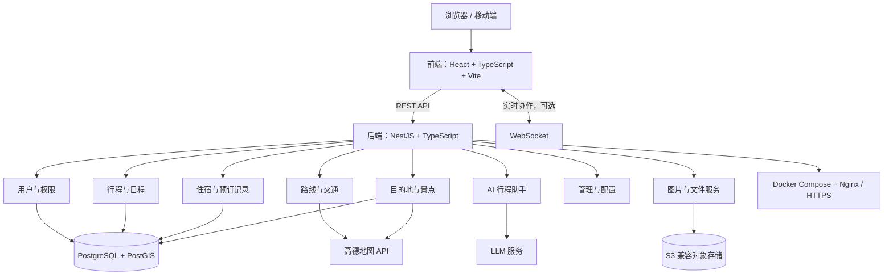

# 系统总体技术架构、技术选型与开发计划

> 本报告整理自《旅行规划助手需求规格说明书-框架稿（修改了附录B和附录C）》的附录 B、附录 C，供项目 GitHub 仓库阅读。

## 附录 B：系统的总体技术架构与技术选型

### B.1 架构设计目标

本项目面向中国境内自由行场景，采用可分阶段交付的前后端分离架构。系统围绕目的地、景点、每日行程、路线、住宿和智能推荐组织业务，支持用户先手动规划，再逐步使用自动编排与 AI 辅助能力。架构优先保证核心行程数据可靠、外部服务可替换、部署方式适合课程项目与后续云端运行。

### B.2 系统总体架构

系统采用前后端分离、模块化的 Web 架构。浏览器或移动端通过 React + TypeScript 前端访问 NestJS + TypeScript 后端；后端通过 REST API 提供业务能力，并连接关系数据库、地图服务、LLM 服务和文件对象存储。多人协作通过 WebSocket 支持。

前端提交行程和用户操作，后端进行权限校验并读写 PostgreSQL；地图展示、地点检索和路线规划调用高德地图 API；AI 建议由后端调用 LLM 服务；图片和附件存入对象存储，数据库保存文件地址与元数据；多人协作时可通过 WebSocket 推送行程变更。

### B.3 技术选型及理由

| 层次 | 选型 | 理由 |
| --- | --- | --- |
| 前端 | React + TypeScript + Vite | 构建响应式 Web/PWA 用户端，支持浏览器和移动端访问；组件化便于实现地图、行程编辑等交互，TypeScript 可减少接口数据错误。 |
| 地图 | 高德地图 Web JS API + Web 服务 API | Web JS API 用于地图展示、标注和交互；服务端 Web 服务 API 用于地点搜索、地理编码和路线规划。密钥按平台要求区分配置，服务端密钥不暴露给浏览器。 |
| 后端 | NestJS + TypeScript | 采用模块化服务端架构，按用户、地点、行程、住宿、路线和 AI 等业务拆分模块；通过 REST API 与前端通信，便于维护和扩展。 |
| 数据库 | PostgreSQL（按需启用 PostGIS） | 关系型数据适合保存用户、行程、日程和住宿记录及其关联；需要区域或距离查询时可使用PostGIS 空间能力。 |
| 媒体存储 | S3 兼容对象存储；开发环境可用本地存储 | 图片和附件与业务数据库分开保存，数据库仅记录文件地址、来源等元数据，便于备份、扩容和后续接入 CDN。 |
| AI 能力 | 服务端 LLM 适配器 | 由后端统一调用可配置的大模型服务，密钥不下发到前端；要求模型返回结构化建议，并经格式和地点校验后由用户确认写入行程。 |
| 部署 | Docker Compose + Nginx/HTTPS 反向代理 | Compose 用于统一启动应用及依赖服务；反向代理负责 HTTPS 和外部流量转发。数据库、上传文件和密钥配置需要持久化或安全保存。 |
| 协作 | WebSocket（可选） | 为多人共同编辑、行程变更通知等实时能力预留；首期可先完成单人行程管理，待协作需求明确后启用。 |

### B.4 数据模型与外部服务边界

核心实体包括用户、目的地、地点、行程、行程日、日程项目、住宿记录和推荐结果。行程及其日程项目归属明确的用户或共享权限范围；地点可以被多个行程引用。数据库保存业务字段、坐标、数据来源、更新时间和必要的服务状态；图片文件本体存储在对象存储中。

高德地图调用分为两类：浏览器端 JS API 用于地图底图、标注和交互；服务端 Web Service API 用于地点检索、地理编码或路线等需要保护密钥的请求。两类 Key 按高德平台要求分别申请、限制来源和配置权限。LLM 调用由后端发起，前端不接触模型密钥。

景点和美食信息应优先使用授权 API、开放数据或人工维护的数据源，并记录来源及更新时间。若无法验证营业时间、票价、设施或图片授权，应明确提示信息可能变化，不将模型生成内容表述为已核实事实。

### B.5 安全与可靠性

全站使用 HTTPS；服务端校验输入、鉴权并按资源执行访问控制。密码使用成熟的单向哈希算法保存；API Key、LLM 密钥和数据库凭据不写入前端代码或仓库。日志避免记录密钥、密码和不必要的个人信息。上传接口限制文件类型、大小和访问权限。

外部 API 设置超时、频率限制和可理解的错误提示；可缓存稳定的地点数据以减少重复请求。地图或模型服务故障时，用户仍可手动创建和编辑行程。数据库和对象存储分别制定备份与恢复流程，生产环境需定期验证备份可用性。

## 附录 C：开发计划

本计划按课程项目总周期 16 周编排。当前处于第 6 周，重点完成需求与总体技术方案确认及中期汇报准备。第 7 周起按阶段交付逐步开发。每周形成可检查成果，并在迭代评审时根据实际进展调整任务。

前 5 周作为前期准备阶段简要处理；第 6 周为当前阶段，后续计划按阶段交付并结合实际进展调整。

### C.1 16 周开发计划

| 周次 | 重点工作与任务 | 阶段产出 / 验收 | 进度 |
| --- | --- | --- | --- |
| 第 6 周 | 当前阶段：核对需求和原型，完成总体技术架构与技术选型说明，准备并进行中期汇报，确认后续 10 周开发范围。 | 需求文档和更新后的开发计划 |  |
| 第 7 周 | 工程基础：创建前后端项目骨架，配置代码规范、环境变量、数据库迁移、Docker 开发环境和基础 CI。 | 可启动的开发环境、健康检查接口 |  |
| 第 8 周 | 账户与基础数据：实现登录鉴权、用户偏好、目的地和地点基础数据结构及管理接口。 | 登录流程、用户与地点基础 API |  |
| 第 9 周 | 地点服务：接入高德地点搜索和地理编码，支持按城市、类别和关键词筛选；记录数据来源。 | POI 搜索与详情、首批目的地数据 |  |
| 第 10 周 | 地图与路线：接入高德地图展示地点标记，完成地点间路线查询、耗时展示和服务异常提示。 | 地图页面、路线查询闭环 |  |
| 第 11 周 | 行程管理与多人协作：实现行程创建、每日安排、手动增删和排序；支持邀请成员、共享行程及协同编辑，并处理成员权限与更新同步。 | 行程管理功能；成员邀请与权限；协同行程更新 |  |
| 第 12 周 | 自动编排与旅行地图：按距离、时间和用户偏好生成可编辑行程；依据旅行记录点亮去过的城市，并在地图展示去过的景点，支持补录历史足迹。 | 可编辑的自动行程；城市点亮与景点足迹地图 |  |
| 第 13 周 | AI 与内容推荐：接入可配置 LLM，生成景点游玩建议及餐饮推荐；校验结构化输出并允许用户确认。 | AI 建议预览与确认流程、失败降级 |  |
| 第 14 周 | 住宿与预订：实现住宿搜索推荐、住宿日期记录，并将住宿关联到行程预订条目；完善预订信息查看和管理。 | 住宿推荐与记录；行程预订条目及管理功能 |  |
| 第 15 周 | 费用管理与系统集成：实现费用记录、分类、成员分摊和汇总；完成主要用户流程回归、权限与异常检查、数据备份恢复验证及云端部署。 | 费用记录、分摊与汇总；候选版本；问题清单与部署说明 |  |
| 第 16 周 | 最终验收与交付：修复阻断问题，确认功能范围和演示数据，整理用户手册、技术文档并完成答辩。 | 最终版本、验收记录、交付文档与演示 |  |
