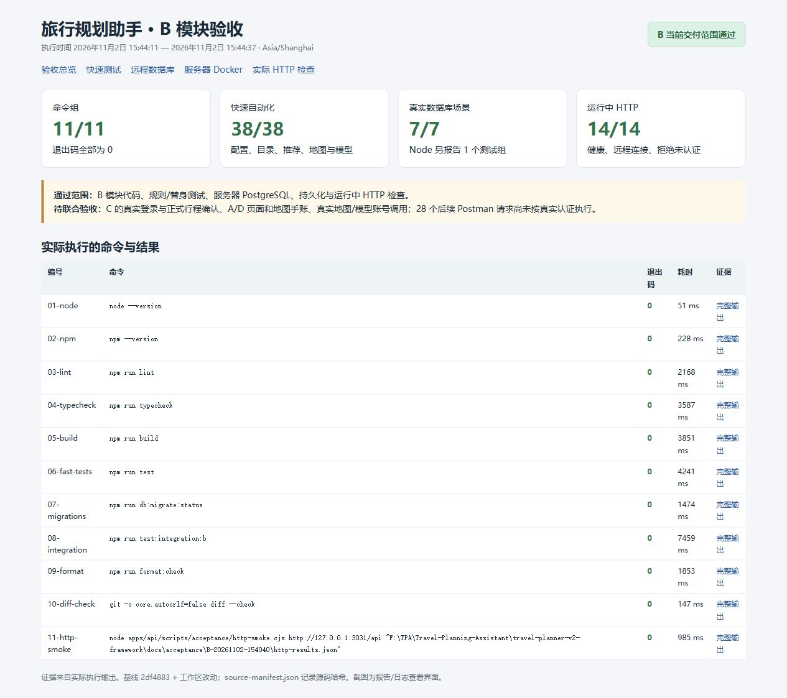
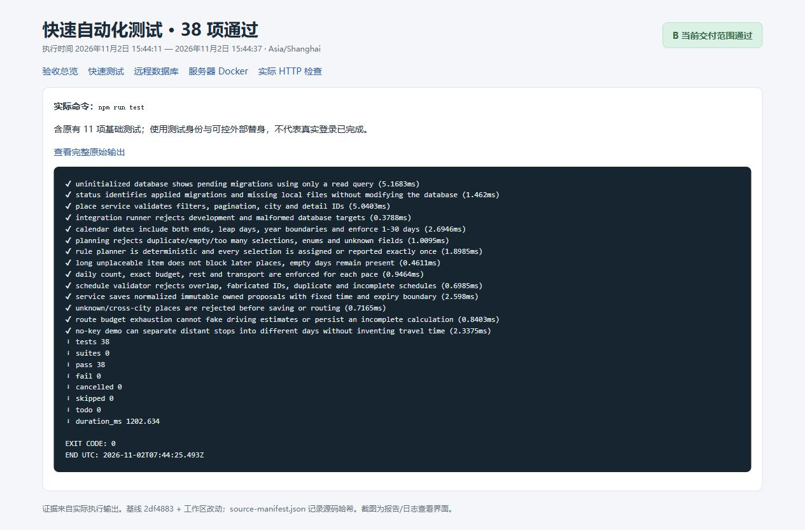
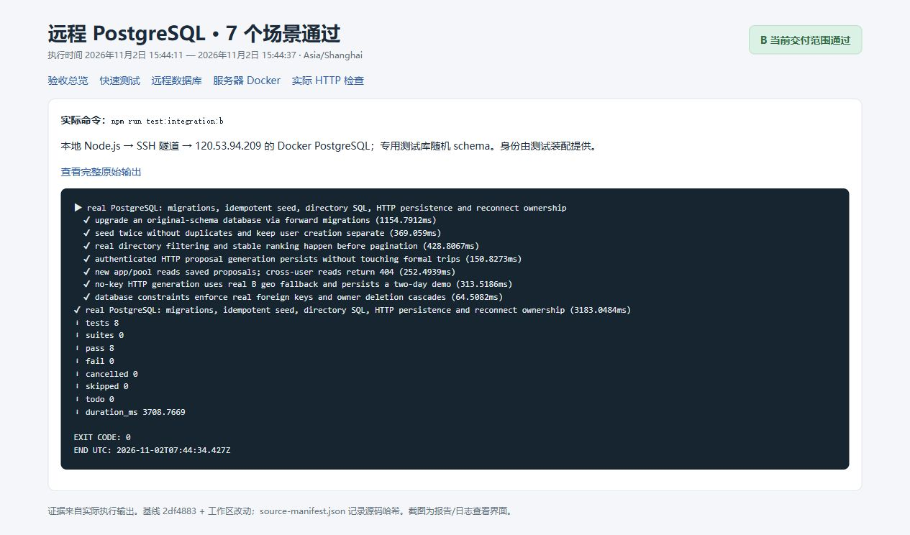
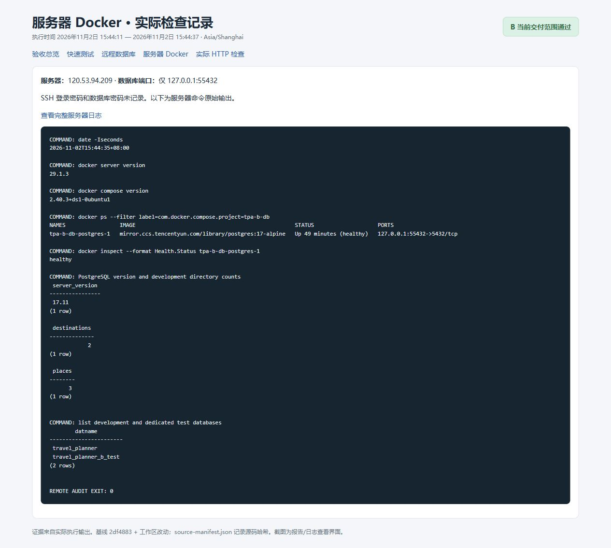
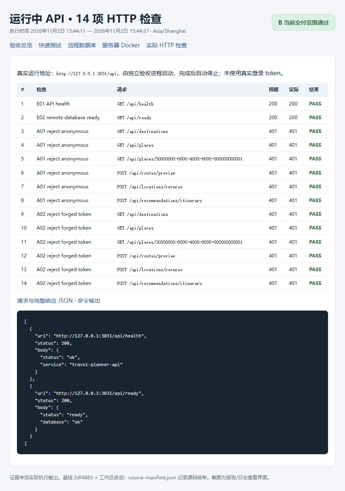

# B 模块本轮验收报告

**结论：当前 B 交付范围验收通过。** 整站真实登录及 A/C/D 联合流程尚待完成。

- 执行时间（上海）：2026年11月2日 15:44:11 至 2026年11月2日 15:44:37
- 基线提交：2df4883df9d2641fb73f7481b7066c38130592c5；包含工作区未提交改动，源码 SHA-256 见 [清单](source-manifest.json)。
- 服务器 Docker：健康，PostgreSQL 17.11，仅监听服务器本机 55432。

| 检查        | 实际结果                             | 证据                                          |
| ----------- | ------------------------------------ | --------------------------------------------- |
| 命令组      | 11/11 通过，失败 0                   | [命令记录](commands.txt)、[CSV](命令结果.csv) |
| 快速测试    | 38/38                                | [原始日志](06-fast-tests.txt)                 |
| 真实数据库  | 7/7 子场景；Node 报告 8 项通过       | [原始日志](08-integration.txt)                |
| 运行中 HTTP | 14/14                                | [完整请求响应](http-results.json)             |
| 服务器检查  | healthy，两个库存在，开发目录 3 景点 | [服务器日志](12-server-docker.txt)            |

## 实际执行流程

1. 通过 SSH 登录既定服务器并建立 55432 端口隧道，凭据仅交互输入。
2. 执行服务器只读检查，保存 Docker/Compose 版本、容器健康、loopback 端口和数据库目录计数。
3. 依次执行 lint、类型检查、前后端构建、快速测试、迁移状态、真实数据库集成、格式和 diff 空白检查。
4. 在本机 3031 端口启动临时 API，实际请求 health、ready，以及六个业务入口的匿名/伪造凭据请求。
5. 保存命令、完整输出、退出码、耗时、HTTP 响应、源码哈希，并生成报告和浏览器截图。
6. 临时 API 自动停止；取证结束关闭本次 SSH 隧道，服务器数据库继续运行。

## 当前未通过真实业务条件执行的部分

- C 尚未提供真实认证及正式行程确认；自动化中的测试身份不等于真实登录。
- A/D 业务页面、地图手账及全站浏览器流程尚未联合验收。
- 真实高德与模型账号调用未验证；相关自动化使用可控替身或明确的无 Key 路径。
- Postman 后续 28 个请求受认证/Key 前提限制，未将它们记为通过；本次 HTTP 检查是 CLI 客户端实际请求，不是 Postman Runner。

## 截图

截图是浏览器中实际打开的验收报告/原始输出查看页，不是伪造的终端界面，也不是业务页面验收。原始文本与 JSON 独立保存，可核对。











## 复跑

在项目根目录开一个终端运行 npm run db:tunnel:b；另一个终端运行：

```powershell
npm run acceptance:b -- --output docs/acceptance/B-新的一轮
```

输出目录应使用新名称以保留本轮证据。commands.txt / commands.ps1 是本次实际命令清单；临时 API 由验收脚本管理，不能将该清单当成独立启动脚本。完整测试流程与用例见 [测试手册](B-完整测试流程与用例.md)。

## 证据完整性

本轮包含 5 张真实浏览器截图，源码清单中的 97 个文件已核对 SHA-256。原始输出、HTTP JSON 与截图的文件校验值见 artifact-manifest.json；完整测试手册、接口文档和 Postman 请求集已随包保存。
