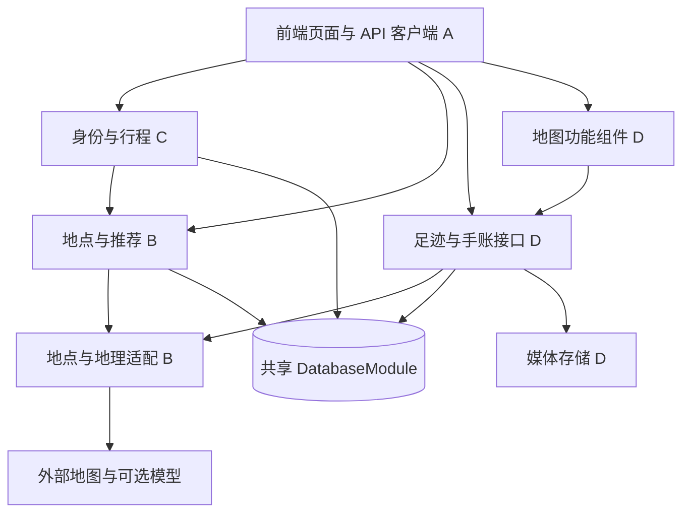

# 四人并行开发总览

本文件是四人开始开发的共同入口。沿用现有 React + Vite、NestJS、PostgreSQL 和 npm workspaces，在一个仓库内按模块开发。四份个人说明拆分工作和测试依赖，不另建四套系统。

## 1. 先分清已有与待实现

| 状态           | 内容                                                                          |
| -------------- | ----------------------------------------------------------------------------- |
| 已有代码       | 配置模块、数据库查询与事务模块、健康检查、开发启动、基础测试、前端 API 状态页 |
| 已有接口       | `GET /api/health`、`GET /api/ready`                                           |
| 已有数据库迁移 | `users`、`trips`、`trip_members` 三张基础表                                   |
| 本次新增       | 总览、接口约定、四份开发说明、联调验收清单和静态示例数据                      |
| 待实现         | 登录、景点、推荐、行程、足迹、图文手账、上传和前端业务页面                    |

本文及配套文件不是业务接口已经可调用的证明。示例 JSON 是测试输入和预期输出，不是运行中的模拟服务器，也不会自动写入数据库。

原代码的问题和已完成重构见 [现有代码问题分析与重构架构](现有代码问题分析与重构架构.md)，历史验证结果见 [架构验证记录](架构验证记录.md)。

## 2. 开发文档入口

| 文档                                                     | 谁先读 | 用途                                         |
| -------------------------------------------------------- | ------ | -------------------------------------------- |
| [接口与数据约定](接口与数据约定.md)                      | 全员   | 字段、接口、错误、版本、日期和坐标的共同约定 |
| [A：前端开发说明](A-前端开发说明.md)                     | A      | 页面、接口客户端、模拟数据和交互验收         |
| [B：API 与智能推荐开发说明](B-API与智能推荐开发说明.md)  | B      | 地点目录、外部适配、推荐算法和方案预览       |
| [C：行程业务开发说明](C-行程业务开发说明.md)             | C      | 身份、草稿、确认保存、编辑和数据库协调       |
| [D：足迹与地图手账开发说明](D-足迹与地图手账开发说明.md) | D      | 地图组件、真实到访、随笔、媒体与城市聚合     |
| [联调与验收说明](联调与验收说明.md)                      | 全员   | 启动条件、模拟与真实测试、接口交接和验收场景 |
| [统一示例](examples/README.md)                           | 全员   | 相同用户、城市、地点和正常/异常数据          |

## 3. 模块调用方向

推荐模块不依赖行程模块。B 提供推荐方案及只读查询，C 验证后保存正式行程。D 通过地点接口使用 B 的数据，不直接查询 B 的内部表。所有需要持久化的模块复用现有数据库模块。

## 4. 代码与协作边界

| 成员 | 主要目录，业务目录待创建                                                                                         | 不能重复负责的内容                 |
| ---- | ---------------------------------------------------------------------------------------------------------------- | ---------------------------------- |
| A    | `apps/web/src/components`、`features/auth`、`features/trip-wizard`、`features/trips`、`features/journals`、`lib` | 不编写后端排程或另存一套正式行程   |
| B    | `apps/api/src/places`、`integrations`、`recommendations`                                                         | 不写正式行程表，不维护用户到访记录 |
| C    | `apps/api/src/auth`、`users`、`trips`，公共后端基础                                                              | 不重复做推荐算法或地图手账功能     |
| D    | `apps/api/src/footprints`、`journals`、`media`；`apps/web/src/features/footprints`                               | 不以计划或行程状态自动创建真实到访 |

A 负责手账表单、列表和详情页面；D 负责这些页面的数据接口与可嵌入地图组件。D 自测时可做仅供开发的地图宿主页，主应用页面和导航仍由 A 维护。

公共文件协调：

- C 负责合并 `apps/api/src/app.module.ts`、公共配置、身份 Guard、数据库迁移及根级工程配置的改动。
- A 负责合并 `apps/web/src/App.tsx`、公共样式、页面路由和基础请求客户端的改动。
- 各负责人维护自己的共享类型文件；`packages/shared/src/index.ts` 由 C 汇总导出，A 复核前端使用。
- `packages/shared` 当前仅用于类型。不得直接把运行时模拟数据、枚举对象或工具函数放入该包后供后端执行；如有需求，先补构建与导出配置。
- 接口变化先改 [接口与数据约定](接口与数据约定.md) 和相关示例，再同步调用方。文档契约优先于旧文档中的概括性接口建议。

## 5. 每个人独立测试的最小闭环

| 成员 | 不等待他人时可完成的闭环                                 | 必须另外完成的真实集成验证                         |
| ---- | -------------------------------------------------------- | -------------------------------------------------- |
| A    | 假客户端返回统一数据，完成四步表单、预览、编辑和错误显示 | 接真实 API 验证登录、保存和刷新恢复                |
| B    | 内存景点、假路线/模型适配器、固定时钟，生成确定性的推荐  | 真实数据库方案保存；配置密钥后的外部服务测试       |
| C    | 假当前用户、假推荐查询和测试数据库，验证行程事务         | 接真实登录 Guard 与 B 的方案仓库，验证权限和并发   |
| D    | 假地点解析、测试存储、测试数据库，地图用固定数据         | 接真实身份、B 的城市解析和浏览器地图，验证图文闭环 |

替换依赖只能放在测试或显式开发入口。公共应用不能通过前端传入的用户 ID、任意请求头或固定全局用户绕过身份验证。依赖未完成时，测试使用替身并如实记录，不能把结果标为整套系统通过。

## 6. 第一轮交付顺序

1. 全员先读接口契约及示例，明确 A/C、B/C、A/D 三处交接。
2. A 做使用假客户端的表单；B 做内存景点与规则推荐；C 做身份与草稿；D 做固定数据地图和到访数据模型。可以同步开始。
3. B、C 先接通景点目录、推荐预览和确认保存；A 再接这条完整流程。
4. D 接入共同身份与地点标识，A 接入手账界面，完成第二条流程。
5. 验证真实数据库、跨用户隔离、并发冲突、图片文件恢复和外部依赖失败。此后再增加可选智能增强功能。

采用同一个仓库的个人分支或各自本地副本。当前目录未发现 Git 仓库元数据，分支流程需要团队先建立共同仓库后使用；不要直接在同一个共享目录中同时编辑文件。首次导入只提交源码和锁文件，不提交 `node_modules`、`.env`、私人照片和构建产物。
