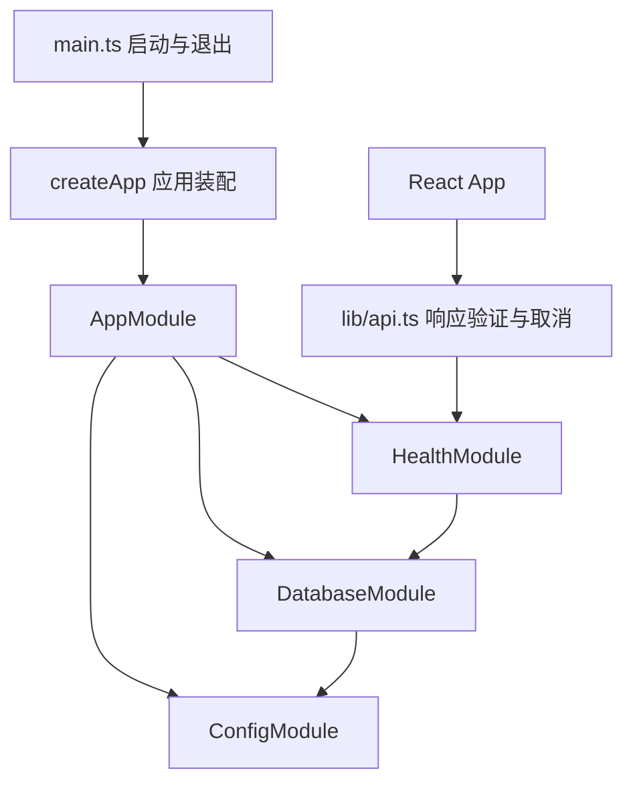
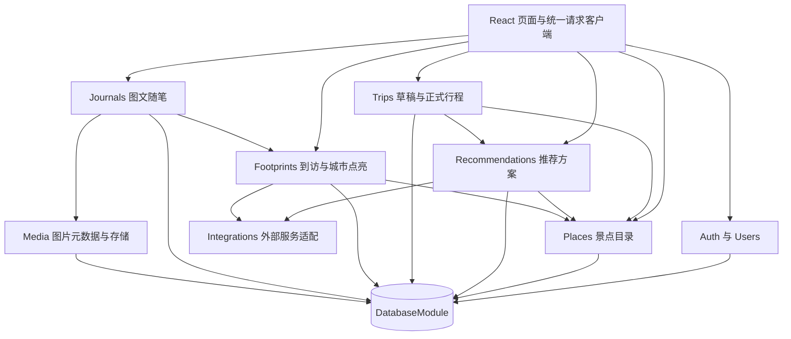

# 现有代码问题分析与重构架构

本次先检查和运行现有工程，再提出架构调整。结论是：现有 React、NestJS、PostgreSQL 和 npm workspaces 可以继续使用，但原项目只有健康检查骨架，开发运行链路存在缺陷，数据库公共能力和业务边界也尚未建立。

本次已将配置、数据库和健康检查改造成可复用模块，并补齐基础测试。旅行推荐、行程管理、地图足迹和图文手账是接下来在该基础上实现的业务模块。本文明确区分原问题、已落地代码和后续设计。

## 1. 检查范围与原始状态

检查了前后端全部现有源文件、共享类型、初始迁移、npm 脚本、Docker 和 CI 配置。使用本机 Node.js 24.21.0 安装锁定依赖，在独立副本验证原始状态；原文件还保存在项目同级的 `travel-planner-v2-framework-2026-10-25_架构调整前备份.zip` 中。

原项目实际结构为：

```text
apps/web/src/App.tsx                 首页与一次健康检查请求
apps/api/src/main.ts                 启动、环境变量、CORS
apps/api/src/app.module.ts           注册数据库服务和健康检查
apps/api/src/health.controller.ts    两个检查接口
apps/api/src/database/               连接池和 SELECT 1
apps/api/migrations/                 users、trips、trip_members
packages/shared/src/index.ts        ApiHealth 类型
```

原项目的 lint、类型检查和构建均通过。这说明工程能通过静态检查，不等于开发模式下的 NestJS 依赖注入已经正常，也不等于旅行业务已经实现。

## 2. 原代码的具体问题

### 2.1 高优先级：开发运行与编译运行不一致

原 `apps/api/package.json:7` 使用 `tsx watch src/main.ts`，而构建使用 TypeScript 编译器。原 `health.controller.ts:6` 的构造器依赖 TypeScript 输出的参数类型元数据来注入 `DatabaseService`，开发路径没有产生这些元数据。

在同一个不可用数据库条件下，实际结果如下：

| 原运行方式          | 构造器参数元数据     | `/api/health` | `/api/ready`      |
| ------------------- | -------------------- | ------------- | ----------------- |
| 开发路径的 tsx 加载 | 缺失                 | 200           | 500，内部错误     |
| tsc 编译后运行      | 包含 DatabaseService | 200           | 503，数据库不可用 |

这个问题会使前端看到 API 存活，却在真正需要注入服务的接口上失败；后续增加构造器注入的业务模块还会受到同类问题影响。

已调整为开发、测试和常规启动都运行 `tsc` 编译后的代码。开发脚本先构建，再并行监视 TypeScript 与 Node 输出；编译启用 `noEmitOnError`，类型检查失败时不输出新的错误代码。

### 2.2 中优先级：迁移状态命令不可用

原 `apps/api/package.json:11` 调用 `node-pg-migrate status`。锁定安装的工具只支持 `up`、`down`、`create` 和 `redo`，实际运行会报 `Invalid Action`，不是一个可用的状态查询。

已增加 `apps/api/scripts/migration-status.cjs`，通过只读查询比较本地迁移与默认 `public.pgmigrations` 表，显示 `pending`、`applied` 和 `missing-file`。查询不会创建迁移表、执行迁移或修改业务数据；数据库未启动时会明确失败。

### 2.3 中优先级：数据库服务不能支持业务模块复用

原 `database.service.ts:6` 直接读取环境变量创建私有连接池，对外只有 `isReady()` 和关闭方法。新增行程、推荐或手账模块时，没有公共查询、事务或可注入的连接池入口，容易出现每人另建连接池、事务跨连接、连接释放不一致的问题。

原连接池也没有显式设置连接及查询时限，检查请求在数据库故障时可能长时间等待。原服务只注册在 AppModule 中，未来子模块无法仅凭父模块拥有该 provider 就自动注入它。

已新增显式导出的 `DatabaseModule` 和可注入连接池。`DatabaseService` 提供参数化 `query()`、同一连接上的 `transaction()`、有时限的连接检查和关闭方法。事务失败时回滚；回滚失败时丢弃连接，同时保留原业务异常。

默认连接等待上限为 2 秒，普通查询为 10 秒，检查查询自身为 2 秒；连接等待和执行是不同阶段，不能把检查总耗时简单描述为固定 2 秒。

### 2.4 中优先级：配置依赖启动目录且缺少校验

原 `main.ts:6` 使用 `process.cwd()` 向上寻找 `.env`。npm workspace 启动时目录恰好匹配，直接从其他目录运行编译产物时，查找位置可能改变。数据库连接、端口和 CORS 的配置读取散落在入口和服务中。

此外，原 Vite 代理固定指向 3000，后端的端口却可以通过 `PORT` 修改，改后端端口会造成前端代理仍请求旧端口。

已用 `ConfigModule` 统一读取和校验配置，按源文件或编译文件的位置定位项目根目录，而不是依赖启动目录。Vite 的开发代理跟随后端端口，也可以通过 `API_PROXY_TARGET` 显式覆盖。

### 2.5 中优先级：CI 缺少运行行为验证

原 CI 会执行迁移、lint、类型检查和构建，但没有 HTTP 或事务行为测试。因此 2.1 的运行问题能通过已有静态检查。项目也没有现成测试脚本用于验证基础能力。

已增加 Node 内置测试运行器的测试，CI 在构建后执行。测试覆盖构造器注入、真实 HTTP 响应、配置错误、事务成功和失败、连接释放、只读迁移状态查询。事务和状态查询使用测试替身，不能据此声称已验证真实 PostgreSQL 的全部行为。

### 2.6 扩展性缺口：尚未形成业务架构

现有 AppModule 只有健康检查和数据库。前端 `App.tsx` 同时负责界面、请求和响应转换，共享包只有健康检查类型。初始 `trips` 表没有城市、偏好、景点选择或每日安排，更没有推荐方案、真实到访和图片随笔的数据模型。

这些是框架阶段的未完成能力，不应当包装成已有功能的故障。架构上需要确定模块的数据归属、调用方向和接口，否则四个人都可能修改同一份行程状态或重复调用同一地图服务。

本次先抽出前端 HTTP 入口和健康检查响应验证，并定义后续业务边界。原页面只检查一次 API 状态，后端稍晚启动时不会自动恢复；已改为每 5 秒检查一次，组件卸载时取消请求和定时器。登录鉴权、DTO 校验、行程接口、推荐算法和手账接口仍需要在后续业务迭代中实现。

### 2.7 开发环境说明不完整

原 README 的本地命令在执行数据库迁移前，没有说明要先启动并准备 PostgreSQL。Docker 的 `node_modules` 使用持久卷，已有卷不会因为镜像重建就自动同步新的锁文件依赖。

已补充本地数据库准备步骤；开发容器启动时先按锁文件安装依赖，再迁移和启动。当前机器 Docker 引擎未运行，本次没有声称完成整套容器启动或真实数据库迁移验证。

## 3. 基于这些问题的架构决定

| 处理方式   | 决定                                                        | 依据                                         |
| ---------- | ----------------------------------------------------------- | -------------------------------------------- |
| 保留       | npm workspaces、React、NestJS、PostgreSQL、pg、现有迁移工具 | 现有构建和类型检查可用，足以支持四人课程项目 |
| 保留       | 现有 users、trips、trip_members 初始迁移                    | 用增量迁移演进，避免破坏已经应用的数据库     |
| 重构并落地 | 配置、数据库、健康检查、启动方式、测试、前端请求入口        | 解决已复现问题，为业务提供统一基础           |
| 明确职责   | 景点与推荐、行程、足迹、手账、媒体分别拥有数据和服务        | 让四人可以独立开发和联调                     |
| 分阶段实现 | 登录、四步规划、确认保存、到访点亮、图文记录                | 围绕两条完整用户流程逐步验收                 |

总体采用模块化单体：前端一个应用，后端一个 NestJS 进程，一个 PostgreSQL 数据库。模块通过导出的服务协作，接口仍统一从 `/api` 提供。

## 4. 本次已经落地的基础架构



对应代码：

```text
apps/api/src/
  main.ts                          监听端口与关闭处理
  app.ts                           可供测试复用的 createApp
  app.module.ts                    只负责组合模块
  config/
    config.module.ts               配置模块导出
    config.service.ts              根目录配置定位与校验
  database/
    database.module.ts             单一连接池 provider
    database.service.ts            查询、事务、就绪和关闭
  health/
    health.module.ts               显式导入数据库模块
    health.controller.ts           存活及数据库连接检查
apps/api/scripts/
  migration-status.cjs             只读迁移状态工具
apps/api/tests/                    基础行为测试
apps/web/src/lib/api.ts            前端 HTTP 入口
packages/shared/src/index.ts       存活与就绪响应类型
```

`AppModule` 不再直接持有业务查询或连接池构造逻辑。未来需要数据库的业务模块显式 `imports: [DatabaseModule]`，通过构造器注入 `DatabaseService`；不能在各模块重新创建 Pool。

`/api/health` 只表示 API 存活，`/api/ready` 表示数据库连接检查结果。后者也不证明所有迁移已应用或地图、AI 外部服务可用。

共享包当前定位为类型契约。后端使用 type-only 导入，避免把当前共享包的 ESM 源文件当作 CommonJS 运行依赖。后续如果加入共享运行时代码，应先为该包补齐构建和导出配置。

## 5. 在现有代码上展开的目标业务架构



所有需要身份的入口应用统一登录 Guard，并进行资源所有权检查；图中的业务调用不能绕过这层检查。浏览器地图展示通过 D 的地图组件接入高德 JS API，服务端地点、路线及模型调用统一由 B 的适配层处理。

### 5.1 后端业务目录

以下目录是下一阶段创建的目标，不是本次已完成的接口：

| 目标目录                         | 负责内容                                 | 负责人 |
| -------------------------------- | ---------------------------------------- | ------ |
| `apps/api/src/auth`              | 注册登录、身份 Guard、当前用户上下文     | C      |
| `apps/api/src/users`             | 用户资料、个人默认偏好                   | C      |
| `apps/api/src/places`            | 目的地、景点目录、类别、来源和缓存       | B      |
| `apps/api/src/integrations/amap` | 地点搜索、逆地理编码、路线适配和超时     | B      |
| `apps/api/src/integrations/llm`  | 可配置模型调用及结构化响应校验           | B      |
| `apps/api/src/recommendations`   | 推荐排序、规则排程、方案预览与保存       | B      |
| `apps/api/src/trips`             | 日期、偏好、已选景点、每日安排、确认方案 | C      |
| `apps/api/src/footprints`        | 实际到访、历史补录、地点标记和城市聚合   | D      |
| `apps/api/src/journals`          | 地点随笔、图片关联、列表和详情           | D      |
| `apps/api/src/media`             | 图片上传、授权读取、元数据和文件清理     | D      |

每个业务模块从 `module + controller + service + dto` 起步。需要维护较多 SQL 时，在模块内增加专门的 `repository`；事务由应用服务组织，内部所有写入使用同一个事务连接，不在 repository 中偷偷切回全局连接池。

### 5.2 前端业务目录

保留现有 App 入口与样式，逐步将原型拆分为：

```text
apps/web/src/
  App.tsx                          应用路由与布局
  lib/api.ts                       统一请求基础
  components/                      通用控件
  features/auth/                   登录注册
  features/trip-wizard/             城市、日期、偏好、景点四步表单
  features/trips/                   行程列表、预览和每日编辑
  features/footprints/              地图组件、城市高亮和地点标记
  features/journals/                随笔与图片界面
```

A 负责整体页面、表单及接口接入；D 可以独立开发地图组件，交由 A 接入页面入口。C 负责截图表单背后的保存和校验，不再重复开发另一套表单前端。

## 6. 两个必须固定的业务边界

### 6.1 推荐方案与正式行程

1. A 将城市、日期、偏好、交通方式和景点选择保存到 C 的草稿接口。
2. B 根据这些条件生成方案预览，返回每日安排、原因、警告和未能安排的景点。
3. 推荐方案归属当前用户，保存输入摘要和有效期；用户修改规划条件后，旧方案不能直接覆盖新草稿。
4. 用户确认后，C 接收 `proposalId` 和 `expectedRevision`，验证方案所有者及条件，在事务中写入正式行程并更新版本。
5. B 导出只读的方案查询服务给 C 使用，B 不导入 TripsModule。正式行程只有 C 负责写入，避免循环依赖和重复保存。

大模型是 B 的可选建议来源。规则排程应在没有模型时独立可用；地点 ID、日期、重复景点、时长和未安排项必须经服务端校验。外部 API 超时要显示失败或注明估算依据，不能伪造实时信息。

### 6.2 行程计划与真实到访

`trips` 保存“打算去哪里”，`visited_places` 保存“用户确认实际去过哪里”。两者有独立的生命周期。

D 依据用户到访记录聚合已点亮城市，不根据推荐结果或行程完成状态自动点亮。用户可以独立于任何行程补录历史到访，并给到访地点写多篇随笔。删除某城市最后一条到访后，该城市恢复未点亮；删除一篇随笔不等于删除到访事实。

到访地点可以关联景点，也可以是地图上手选的位置；保存地点名称、坐标系和城市信息快照，避免公共景点资料变化破坏个人记录。

## 7. 数据库演进

初始迁移保持原样。本次没有向数据库写入新业务表，以下为下一阶段的增量迁移分组：

| 分组       | 主要表与字段                                                                 | 负责人 |
| ---------- | ---------------------------------------------------------------------------- | ------ |
| 身份与目录 | users 登录凭据；destinations、places；坐标系、来源、更新时间                 | C、B   |
| 行程       | trips 的城市、偏好、节奏、状态和版本；trip_selections、trip_days、trip_items | C      |
| 推荐       | recommendation_proposals 的所有者、输入摘要、方案 JSON 和有效期              | B      |
| 足迹       | visited_places 的所有者、地点快照、城市、实际到访日期                        | D      |
| 随笔与媒体 | journal_entries、media_assets、journal_media                                 | D      |

城市点亮从到访记录计算，首期不单独维护容易失去同步的点亮布尔值。图片文件存于持久化媒体存储，数据库保存标识和关联；读写图片同样校验用户归属。

旅行日期按目的地日历处理，包含首尾日期，首期国内示范使用 `Asia/Shanghai`。景点选择、每天的日程项和推荐方案是不同概念，不能只用 trips 表里的一个无约束 JSON 字段代替所有数据和校验。

## 8. 分工与迁移顺序

| 阶段                | 改动与交付                                                                       | 验收条件                               |
| ------------------- | -------------------------------------------------------------------------------- | -------------------------------------- |
| 0：基础重构（本次） | 配置、数据库、健康检查、启动脚本、只读状态工具、运行测试、前端请求入口           | 静态检查通过；健康和故障分支行为明确   |
| 1：接口与基础数据   | A 定义四步表单；B 提供示范城市和景点；C 实现登录与草稿；D 提供地图原型及到访契约 | 登录后能保存和恢复自己的规划条件       |
| 2：规划流程         | B 规则排程；C 确认保存及手动调整；A 联调预览和编辑                               | 已选景点能生成、确认、编辑和再次读取   |
| 3：手账流程         | D 实现真实到访、图片随笔、城市聚合；A 接入手账界面                               | 到访后点亮城市，点开地点能回看图文     |
| 4：集成与完善       | 外部服务降级、用户隔离、媒体清理、真实数据库、Docker 与部署验证                  | 两条主流程可复现，故障不破坏已保存数据 |

接口示例、共享类型和验收样例应在每阶段开始时确定。详细业务接口与四人分工见 [项目架构与四人分工](项目架构与四人分工.md)，该文件作为本方案的业务补充。

## 9. 验证与限制

基础检查包括 `npm run lint`、`npm run typecheck`、`npm run build` 和 `npm test`。11 项基础测试在本机通过；测试通过后的启动与代理检查记录在 [架构验证记录](架构验证记录.md)。

未把真实 PostgreSQL 迁移、Docker 全栈运行、第三方地图或大模型调用当作已完成验证。当前机器 Docker 引擎不可用，第三方接口也尚未编写。实际业务登录、鉴权、输入 DTO、推荐和手账接口仍按上述阶段开发。

原需求说明书中的 Web 与小程序、多人协作是否属于首期的冲突，需要团队按本方案统一：先交付响应式 Web 下的个人行程与地图手账，扩展功能另行确认。
