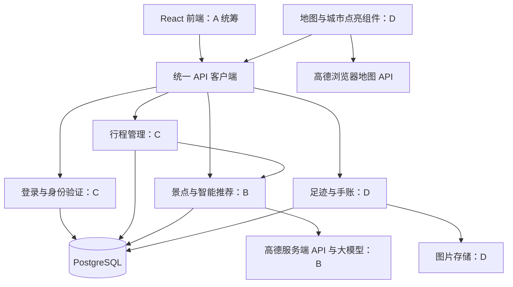

# 旅行规划与地图手账项目架构

现有代码的具体问题、已落地的基础重构和分阶段迁移以 [现有代码问题分析与重构架构](现有代码问题分析与重构架构.md) 为主。本文作为业务模块与四人职责的详细补充。

四人小范围独立开发时，使用 [并行开发总览](总体架构.md) 中的个人说明、[接口与数据约定](接口与数据约定.md) 及共同示例。接口的具体字段与行为以该契约为准，本文保留总体业务说明。

本方案在现有 React、TypeScript、Vite、NestJS 和 PostgreSQL 项目上展开，面向四人课程团队。产品包含两条主流程：旅行前选择目的地、日期、偏好和景点，生成并保存可修改的行程；旅行后在地图上标记真实到访的地点，添加图片和随笔，积累个人旅行手账。

本文规定后续开发的模块、负责人和接口。当前仓库已有前后端骨架、模块化配置与数据库服务、健康检查、运行测试及三张初始数据库表；下文新增的业务目录、表和接口属于待开发设计，不表示已经实现。

## 1. 产品范围

客户端采用适配手机和电脑浏览器的响应式 Web 应用，沿用现有技术栈。首页可继续使用此前的省份地图卡片风格，日期、偏好和景点选择参考提供的三张截图。

第一版实现以下功能：

1. 账号注册、登录，查看自己的行程和手账。
2. 选择城市、出发和返回日期，设置主题偏好、出行节奏和交通方式。
3. 搜索景点、查看推荐依据，添加和移除已选景点。
4. 生成每日行程预览，确认后保存；支持手动增删、换日和排序。
5. 标记实际到访地点和日期，在地图上显示地点，并点亮对应城市。
6. 为到访地点撰写随笔、上传图片，并按地点或时间回看。

首期准备一个示范省份及其中一至两个城市的景点数据。省份卡片可以用于展示，但有可选景点的目的地以实际数据为准。智能推荐先提供可复现的规则方案，再增加可配置的大模型建议。

## 2. 四人职责

| 成员                         | 主要职责                                                                                     | 负责代码                                                               | 可独立交付的成果                               |
| ---------------------------- | -------------------------------------------------------------------------------------------- | ---------------------------------------------------------------------- | ---------------------------------------------- |
| A：前端负责人                | 统一布局、路由、登录页、首页、创建行程四步表单、行程编辑页、手账表单和接口联调               | `apps/web` 的页面、通用组件和 API 客户端                               | 用户能在统一界面中完成两条主流程               |
| B：外部 API 与智能推荐负责人 | 目的地与景点数据、高德服务端调用、路线时间查询、规则排程、大模型建议和失败降级               | API 的 `places`、`integrations`、`recommendations`                     | 输入日期、偏好和景点，返回可解释的每日方案预览 |
| C：行程业务与基础后端负责人  | 截图对应的日期、偏好和景点选择的校验与保存；行程增删改查、每日安排、登录鉴权、数据库公共能力 | API 的 `auth`、`users`、`trips`、`database`                            | 行程草稿、推荐确认保存、手动调整、用户数据隔离 |
| D：地图足迹与手账负责人      | 到访地点、城市点亮、图片和随笔、媒体存储；实现可接入主界面的地图组件                         | API 的 `footprints`、`journals`、`media`，Web 的 `features/footprints` | 地图标记、城市高亮、地点手账和图片回看         |

C 对应的并不是再做一套截图前端，而是实现这些表单背后的业务和持久化；A 负责表单界面，C 提供接口。D 的地图组件作为独立功能组件交给 A 接入，A 负责页面入口和整体交互。手账列表、编辑表单由 A 实现，D 提供接口及地图联动。

数据库迁移由各模块负责人编写，C 负责合并检查。每个人为自己的模块提供接口示例和关键验证，A 汇总两条主流程的联调结果。基础 Docker 和 CI 继续复用现有配置，由 C 维护。

## 3. 总体架构

采用一个前端应用、一个按业务拆模块的 NestJS 后端和一个 PostgreSQL 数据库。各模块可以分别开发，在同一个后端进程内运行。



浏览器地图 JS Key 用于地图展示；高德服务端 Key 和大模型 Key 只在 NestJS 中使用。B 统一封装服务端外部调用，D 通过这些服务完成逆地理编码等需求，不重复维护一套外部调用逻辑。

## 4. 建议目录

以下是目标目录；已有文件按原功能保留，开发对应功能时再创建业务目录。

```text
apps/
  web/src/
    App.tsx                         路由与应用入口，A
    components/                     通用界面组件，A
    lib/api/                        请求、登录状态和错误处理，A
    features/
      auth/                         登录注册界面，A
      trips/                        行程列表、编辑与每日安排，A
      trip-wizard/                  城市、日期、偏好、景点四步表单，A
      footprints/                   地图、标记和城市高亮，D
      journals/                     图片与随笔界面，A 与 D 联调
  api/src/
    main.ts                         端口监听与关闭；业务校验后续补充
    app.ts                          应用装配与测试入口
    app.module.ts                   注册业务模块
    config/                         已实现配置读取与校验
    health/                         已实现健康检查模块
    database/                       连接池、参数化查询和事务，C
    auth/                           注册登录、身份 Guard，C
    users/                          当前用户资料和默认偏好，C
    places/                         目的地、景点与数据缓存，B
    integrations/
      amap/                         地点、路线和逆地理编码，B
      llm/                          大模型调用与响应校验，B
    recommendations/                推荐排序、规则排程和方案预览，B
    trips/                          草稿、每日行程和确认保存，C
    footprints/                     实际到访与城市点亮，D
    journals/                       随笔和图片关联，D
    media/                          上传、授权读取和文件清理，D
  api/migrations/                   各成员新增数据库迁移
packages/shared/src/
  index.ts                          统一导出共享类型
  auth.ts                           登录和当前用户类型
  places.ts                         目的地、景点、坐标类型
  trips.ts                          行程与偏好类型
  recommendations.ts                推荐请求与方案类型
  journals.ts                       足迹、手账和媒体类型
docs/
  项目架构与四人分工.md             本文
  api-contracts.md                   开发第一步共同补齐接口示例
```

普通业务模块以 `*.module.ts`、`*.controller.ts`、`*.service.ts` 和 `dto/` 为基本结构。Controller 负责接口入口和身份信息，Service 处理业务、查询和事务，DTO 负责输入校验。当前直接使用 `pg` 即可，共享连接池由 `DatabaseModule` 导出给业务模块。

共享 TypeScript 类型用于对齐前后端，不替代后端运行时校验；数据库结构变更仍需要迁移。

## 5. 截图功能由谁实现

| 截图步骤 | 前端 A 的工作                      | 行程后端 C 的工作                        | 推荐负责人 B 的工作                        |
| -------- | ---------------------------------- | ---------------------------------------- | ------------------------------------------ |
| 选择日期 | 日期控件、前后步骤切换、展示总天数 | 校验日期先后、保存日期范围、生成每日容器 | 按有效天数分配景点                         |
| 设置偏好 | 主题多选、节奏单选、状态回显       | 保存主题、节奏、交通方式                 | 根据类别匹配偏好、提供明确的推荐原因       |
| 选择景点 | 搜索、勾选、移除、已选列表排序     | 保存已选景点和用户指定顺序               | 提供景点列表、搜索和建议游玩时长           |
| 生成行程 | 展示加载、预览、警告和确认按钮     | 确认后保存每日景点，支持手动调整         | 生成每日安排、路线时间和无法安排的景点列表 |

D 不负责这四步表单，而是负责旅行完成后的地点记录及地图手账。行程详情页可以提供“记录到访”入口，将地点交给 D 的表单，由用户确认真实到访日期。

## 6. 两条主流程

### 6.1 旅行规划

1. A 展示目的地列表，用户选择城市后，C 创建当前用户的行程草稿。
2. 日期、偏好、节奏、交通方式和已选景点通过 C 的接口保存；刷新后能够恢复。
3. B 接收完整的规划条件，查询本地景点数据和必要的外部服务，生成候选方案。
4. A 展示每日安排、推荐原因和警告，用户可以重新生成或回到上一步修改。
5. 用户确认后，C 校验方案所属用户及其输入条件，用事务写入行程日和日程项。
6. 用户通过 C 的接口调整景点、换日和排序，再次打开仍得到已保存的结果。

B 生成方案预览，不直接覆盖正式行程。C 是正式行程的唯一写入入口；C 可以调用 B 导出的方案查询服务，B 不反向依赖 C 的行程模块，避免循环依赖。

### 6.2 地图点亮与图文手账

1. 用户在地图选择地点，或从已保存行程进入“记录到访”。
2. D 保存用户确认的地点、实际到访日期和城市信息。没有准确定位时允许手动选择。
3. 用户为这次到访添加标题、随笔和图片；D 保存文字及图片关联。
4. 足迹地图展示地点标记，根据实际到访地点所属的城市，计算已点亮的城市。
5. 点击标记后展示对应随笔和图片，支持修改、删除及历史日期补录。

计划中的景点、推荐列表和行程完成状态都不能自动作为到访证据。首次明确记录到访才点亮城市；一个城市最后一条到访记录删除后，该城市恢复未点亮状态。按年份筛选时，城市点亮和地点标记使用同一筛选范围。

## 7. 数据模型与归属

保留初始迁移中的 `users`、`trips` 和 `trip_members`。通过新迁移扩展，不修改已经应用过的旧迁移。`trip_members` 作为后续能力预留，第一版行程按所有者授权访问。

| 表                         | 关键内容                                                      | 负责人 |
| -------------------------- | ------------------------------------------------------------- | ------ |
| `users`（扩展）            | 密码哈希、显示名称；个人默认偏好可单独存储或增加字段          | C      |
| `destinations`             | 省份、城市、父级关系、行政区代码和时区                        | B      |
| `places`                   | 景点名称、城市、坐标及坐标系、类别、建议时长、来源和更新时间  | B      |
| `trips`（扩展）            | 所有者、目的城市、日期、偏好、节奏、交通方式、状态和版本号    | C      |
| `trip_selections`          | 用户为行程选中的景点及选择顺序                                | C      |
| `trip_days`                | 所属行程、当地日期、当天开始和结束时间                        | C      |
| `trip_items`               | 所属行程日、景点、排序、游玩时长、交通估时及其来源            | C      |
| `recommendation_proposals` | 所属用户、规划输入摘要、方案 JSON、来源、警告及过期时间       | B      |
| `visited_places`           | 所属用户、可选景点 ID、地点名称快照、坐标、城市、实际到访日期 | D      |
| `journal_entries`          | 所属用户、到访记录 ID、标题、随笔和创建时间                   | D      |
| `media_assets`             | 所属用户、存储标识、真实文件类型、大小和上传状态              | D      |
| `journal_media`            | 随笔与图片的关联、图片排列顺序                                | D      |

一次到访可以有多篇随笔，一篇随笔可以有多张图片。地点名称和坐标在到访记录中保留快照，避免景点资料更新后个人历史记录被意外改变。到访记录可以关联已有景点，也可以来自用户手动选择的地图位置。

图片文件存到媒体存储，数据库只记录元数据和关联。开发阶段可使用服务端本地目录，部署时挂载持久卷；后续通过同一个存储接口接入 S3 兼容存储。读取私人图片需进行身份和所有权检查。

城市点亮数据由 `visited_places` 聚合得到，首期无需另建一份独立的“已点亮城市”状态，防止删改手账后地图状态不一致。

## 8. 第一版接口划分

以下接口统一以 `/api` 开头。健康检查保持现有约定；注册和登录之外的业务接口需要身份验证，个人数据访问还要校验所有者。表中路径为拟定契约，联调前写入 `docs/api-contracts.md` 确认。

| 负责人 | 方法与路径                                                                        | 用途                             |
| ------ | --------------------------------------------------------------------------------- | -------------------------------- |
| C      | `POST /auth/register`、`POST /auth/login`                                         | 注册和登录                       |
| C      | `GET /users/me`、`PATCH /users/me`                                                | 用户资料及默认偏好               |
| B      | `GET /destinations`                                                               | 已支持的省份和城市               |
| B      | `GET /places`、`GET /places/:id`                                                  | 搜索和查询景点                   |
| B      | `POST /routes/preview`                                                            | 查询地点间路线和交通估时         |
| B      | `POST /locations/reverse`                                                         | 地图位置转换为地点名称和城市     |
| B      | `POST /recommendations/itinerary`                                                 | 生成推荐方案预览                 |
| C      | `POST /trips`、`GET /trips`                                                       | 新建草稿和查看个人行程列表       |
| C      | `GET /trips/:id`、`PATCH /trips/:id`、`DELETE /trips/:id`                         | 行程详情、条件修改和删除         |
| C      | `PUT /trips/:id/selections`                                                       | 完整替换已选景点及顺序           |
| C      | `POST /trips/:id/apply-proposal`                                                  | 用户确认后保存推荐方案           |
| C      | `PUT /trips/:id/schedule`                                                         | 保存手动编辑后的每日安排         |
| D      | `GET /footprints`                                                                 | 返回当前用户的到访标记和点亮城市 |
| D      | `POST /visited-places`、`PATCH /visited-places/:id`、`DELETE /visited-places/:id` | 到访记录增删改                   |
| D      | `GET /journals`、`POST /journals`                                                 | 查询和创建地点随笔               |
| D      | `GET /journals/:id`、`PATCH /journals/:id`、`DELETE /journals/:id`                | 随笔详情和编辑                   |
| D      | `POST /media`、`GET /media/:id`、`DELETE /media/:id`                              | 图片上传、授权读取和删除         |

`GET /places` 约定 `cityId`、`keyword`、`category` 和分页参数；主题筛选或排序使用明确的偏好字段。足迹和手账查询支持 `cityId`、`year` 等筛选，并由登录身份确定用户，不接收可任意指定的查询用户 ID。

## 9. 推荐模块与行程模块的接口边界

B 接收的规划条件至少包含：

```ts
interface PlanningInput {
  cityId: string;
  startDate: string; // YYYY-MM-DD，目的地当地日期
  endDate: string;
  themes: string[];
  pace: 'relaxed' | 'standard' | 'intensive';
  transportMode: 'walking' | 'driving' | 'transit';
  selectedPlaceIds: string[];
}
```

B 返回的方案包含 `proposalId`、输入摘要、生成与过期时间、`days`、`unassignedPlaceIds`、`warnings` 及 `source`。`days` 记录日期、景点顺序、游玩时长、交通估时和推荐原因。方案在服务端关联当前用户，前端不能只凭自造的 JSON 直接当成可信推荐保存。

用户确认时，A 向 C 提交 `proposalId` 和当前行程的 `expectedRevision`。C 读取方案，检查所有者、有效期、输入条件与当前草稿是否一致，再校验景点、日期和时长后保存，并递增行程版本。方案过期、条件变化或版本冲突时返回明确错误，由用户重新生成或刷新，不能覆盖较新的编辑。

如果有无法安排的景点，预览必须逐一展示，要求用户调整日期、节奏或选择后重新生成；不默默删除景点，也不把不完整方案标记为全部安排成功。

规则排程根据偏好、地理位置、游玩时长和每天可用时间产生基础方案；路线 API 可提供更准确的分段估时。无法取得路线时，可以使用注明“估算”的距离结果，保留交通方式和计算依据，不能伪称为实时路线。

大模型用于补充说明或提出候选顺序。B 必须校验景点 ID、归属城市、日期、重复项和时长，不将模型编造的票价、开放时间或地点直接当作事实。关闭大模型或调用失败时，基础规则方案仍可使用。

## 10. 日期、地图与图片约定

- 日期范围包含出发日和返回日，同日旅行为一天；默认支持 1 至 30 天。按目的地时区处理日历日期，国内示范使用 `Asia/Shanghai`，不能用跨时区 UTC 毫秒差直接算天数。
- 草稿可分步保存；生成方案前，城市、日期和已选景点必须完整。节奏参数由 B、C 和 A 共同固定，避免界面写“每天 2 处”而后端按另一个规则生成。
- 修改已生成行程的日期、城市或已选景点会影响安排。界面先提示，C 要求明确确认后才在事务中清理受影响安排并回到草稿状态，避免无提示丢失用户编辑。
- 地点和路线都携带坐标系。地图展示和高德路线统一使用 GCJ-02；浏览器定位等 WGS84 来源先经 B 的适配层转换，避免足迹位置偏移。
- 城市高亮通过行政区代码匹配有合法来源的行政边界；D 负责地图渲染和边界资源，B 提供行政区与地点解析。无法确定城市的记录先保留地点标记，待用户确认后再参与城市聚合。
- 图片首期支持 JPEG、PNG 和 WebP，单张限制 10 MB，一篇随笔最多 9 张。D 在服务端验证类型和大小、生成存储名并检查所有权；A 提供上传进度、预览和删除交互。
- 未关联随笔的临时图片定期清理；删除随笔时先解除关联，确认图片不再被引用后再清理文件，数据库操作失败时不能先删掉仍被引用的图片。

## 11. 公共工程约定

接口与实体 ID 使用已有的 UUID 方式。A 与各后端负责人共同维护共享类型和接口示例；新增接口先约定请求、响应和错误，再并行实现。

普通成功接口返回明确的资源对象或列表分页对象；失败使用一致的 `code`、`message` 和可选 `details`。建议明确区分输入错误、未登录、资源不存在、版本冲突和外部服务不可用；未授权访问他人的私人资源返回不泄露其存在性的错误。

C 在入口增加全局 DTO 校验、登录 Guard 和统一错误处理，数据库服务提供参数化查询及事务。A 的统一请求客户端处理登录过期、加载和失败状态。B 设置外部请求超时并控制调用频率。D 处理媒体写入、数据库关联和文件清理之间的失败情况。

迁移按依赖顺序合并：用户和目的地基础数据，再是行程与推荐，再是足迹与媒体。不同成员创建不同时间戳文件，新增外键前确认被引用表已经存在。已提交并应用过的迁移不回头修改。

## 12. 开发顺序与验收

| 阶段          | A                                  | B                                | C                              | D                                  | 联合验收                                         |
| ------------- | ---------------------------------- | -------------------------------- | ------------------------------ | ---------------------------------- | ------------------------------------------------ |
| 1：约定与基础 | 页面路由、统一请求客户端、表单原型 | 示例城市及景点数据、推荐接口示例 | 登录、公共数据库能力、草稿接口 | 地图组件原型、足迹与图片接口示例   | 登录后能保存并恢复一个行程草稿                   |
| 2：规划闭环   | 四步表单、预览和行程编辑页         | 偏好排序、规则排程、路线适配     | 选择保存、确认方案和手动安排   | 到访标记与城市聚合接口             | 已选景点生成每日安排，确认保存并刷新恢复         |
| 3：手账闭环   | 手账表单、列表和详情接入           | 逆地理编码、外部异常降级         | 跨模块身份与归属检查、联调支持 | 图片上传、随笔、城市高亮、历史补录 | 新增到访与图文手账，地图可点开回看               |
| 4：完善       | 手机适配、失败与空状态             | 可选大模型建议及结果校验         | 数据一致性、迁移和部署验证     | 删除与文件清理、地图筛选           | 外部服务失败仍可编辑保存，两位用户的数据互不混淆 |

分工验收关注真实结果：A 展示完整交互；B 提供给定输入可复现的基础方案及外部失败处理；C 展示保存、修改、版本冲突与用户隔离；D 展示地点到访、城市点亮、图片随笔和删改后的地图同步。

整体验收至少包含：选择三天并生成三天容器；有景点安排不下时明确提示；修改日期不静默丢失安排；未确认的推荐不覆盖正式行程；计划中的景点不会自动点亮地图；删除某城市最后一次到访后该城市不再点亮；用户不能读写其他人的行程、随笔和图片。

## 13. 与原有材料的衔接

原需求说明书中“微信小程序”与后续 Web 技术架构的表述，以及“首期不做多人协作”与后续协作计划的表述需要统一。本方案按现有代码确定首期为响应式 Web，核心交付为个人行程规划和个人地图手账。分享、多人协作、费用及住宿等扩展在这两条流程完成后另行排期。

此前制作的 HTML 页面可作为 A 的交互和视觉参考，逐步拆成 React 组件；表单与行程数据通过 C 的接口保存，景点与推荐通过 B 的接口取得，真实到访及图文记录通过 D 的接口保存。原型中浏览器本地存储的演示数据需要在联调时替换为当前用户的服务端数据。
