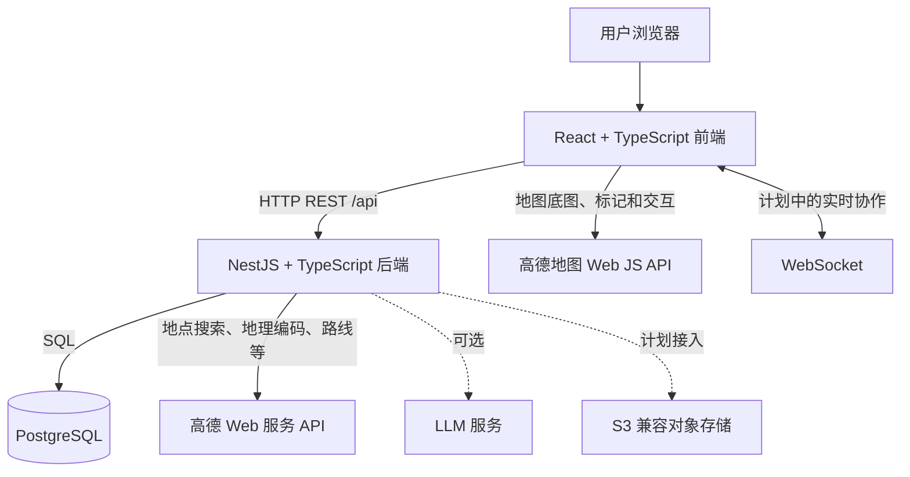

# 旅行规划助手 v2 项目入门

## 1. 这个项目是什么

`travel-planner-v2` 是旅行规划助手的重写版。它是一个前后端分离的 Web 应用：浏览器负责展示和交互，后端负责业务规则、数据读写和外部服务调用，PostgreSQL 保存结构化业务数据。

本项目与旧 TT 项目分开维护。新功能应在本目录下开发；旧项目只作为理解现有功能和业务经验的参考。当前目录是可运行的开发骨架，不代表需求规格书中的功能都已经完成。

## 2. 整体如何工作



一次典型请求按以下顺序完成：

1. 用户在 React 页面上查看或编辑行程。
2. 前端通过 `/api/...` 请求 NestJS 后端。开发时 Vite 将 `/api` 请求代理到 `localhost:3000`。
3. 后端验证请求和权限，执行旅行规划等业务逻辑，再读写 PostgreSQL。
4. 需要地图数据时，浏览器使用高德 JS API 显示地图；需要服务端地点检索或路线结果时，由后端调用高德 Web 服务 API。
5. 后端把 JSON 结果返回前端，页面更新显示。

服务端密钥只由后端读取。`VITE_` 开头的变量会进入浏览器，不能放服务端秘密。

## 3. 技术栈和职责边界

| 部分 | 技术 | 负责内容 |
|---|---|---|
| 前端 | React、TypeScript、Vite | 页面、交互、表单、地图展示、调用后端 API |
| 后端 | NestJS、TypeScript、REST API | 认证授权、行程业务、规划逻辑、地图数据接口、数据读写、外部服务封装 |
| 数据库 | PostgreSQL；空间需求明确后可加 PostGIS | 保存用户、行程、地点、住宿、费用、旅行足迹等结构化数据 |
| 地图 | 高德 JS API + 高德 Web 服务 API | 前者在浏览器绘图；后者由服务端请求地点、地理编码和路线数据 |
| 文件 | S3 兼容对象存储，计划接入 | 保存照片和附件；数据库只保存文件标识、地址和相关元数据 |
| 实时协作 | WebSocket，计划接入 | 多人编辑时推送变更；断线时仍可通过 REST 保存和刷新 |
| 本地环境 | Docker Compose | 统一启动 PostgreSQL，也可启动完整开发容器 |
| 代码质量 | ESLint、Prettier、TypeScript strict | 检查代码风格、格式和类型 |
| CI | GitHub Actions | 自动安装依赖、执行数据库迁移、lint、类型检查和构建 |

浏览器端地图 Key（`VITE_AMAP_WEB_KEY`）不是秘密，必须在高德控制台配置域名白名单。高德 Web 服务 Key、LLM Key、数据库密码等服务端机密不应进入前端或 Git。

## 4. 目录结构

```text
travel-planner-v2/
├─ apps/
│  ├─ web/                       # React 前端
│  │  ├─ src/App.tsx              # 当前骨架页面，检查 API 连接状态
│  │  ├─ src/main.tsx             # 前端启动入口
│  │  ├─ src/style.css            # 全局基础样式
│  │  └─ vite.config.ts           # 开发服务器和 /api 代理
│  └─ api/                       # NestJS 后端
│     ├─ src/main.ts              # 后端入口、CORS、/api 前缀
│     ├─ src/app.module.ts        # 根模块；新业务模块从这里注册
│     ├─ src/health.controller.ts # /api/health 与 /api/ready
│     ├─ src/database/            # PostgreSQL 连接
│     └─ migrations/              # 数据库版本迁移
├─ packages/
│  └─ shared/                    # 前后端共用的 TypeScript 类型
├─ .env.example                  # 环境变量模板，不含真实密钥
├─ docker-compose.yml            # PostgreSQL 和完整开发环境
├─ Dockerfile.dev                # 开发用容器
├─ package.json                  # npm workspace 和统一命令
├─ package-lock.json             # 锁定依赖版本
├─ eslint.config.js              # ESLint 规则
├─ .prettierrc.json              # Prettier 规则
└─ tsconfig.base.json             # TypeScript 公共配置
```

## 5. 当前已经能做什么

当前骨架有以下基础能力：

- 前端可启动并请求后端健康检查。
- 后端提供 `GET /api/health`，用于检查 API 进程是否运行。
- 后端提供 `GET /api/ready`，用于检查 API 是否能连上数据库。
- PostgreSQL 初始迁移建立 `users`、`trips`、`trip_members` 三张表。
- 数据库变化通过迁移管理，便于每位成员和 CI 得到一致结构。
- Docker Compose 可启动 PostgreSQL 和开发容器。
- CI 配置可执行迁移、lint、类型检查和构建。

注册登录、具体行程增删改查、景点检索、路线规划、旅行足迹、住宿预订条目、费用管理、上传照片和实时协作都还需要按开发计划实现。住宿和费用是记录/规划功能，不表示系统已经连接交易平台或可以支付。

## 6. 准备环境

需要：

- Node.js 22.12 或更高版本
- npm
- Docker Desktop（运行 PostgreSQL 或完整容器环境时需要）
- Git

在 PowerShell 中进入项目目录并复制环境变量模板：

```powershell
cd "C:\Users\21202\Documents\ChatGPT\软件工程大作业\travel-planner-v2"
Copy-Item .env.example .env
```

按需要编辑 `.env`。本地开发可以先不填高德和 LLM Key；没有地图 Key 时相关地图服务功能无法请求真实数据，但基础页面和 API 仍可运行。不要把 `.env` 发到 GitHub 或发给团队成员，团队共享 `.env.example`，每个人在本机创建自己的 `.env`。

## 7. 推荐的本地启动方式

当 Docker Hub 网络不稳定时，推荐只用 Docker 运行 PostgreSQL，前后端在本机运行：

```powershell
docker compose up -d postgres
npm ci
npm run db:migrate
npm run dev
```

打开：

- 前端：<http://localhost:5173>
- API 健康检查：<http://localhost:3000/api/health>
- 数据库就绪检查：<http://localhost:3000/api/ready>

运行 `npm run dev` 的终端要保持打开。停止前后端按 `Ctrl+C`；停止数据库运行 `docker compose stop postgres`。普通 `docker compose down` 会停止并移除容器，但保留名为 `postgres_data` 的数据库卷。

也可以用 Docker 启动前后端和数据库：

```powershell
docker compose up --build
```

首次构建需要下载 Node 镜像和 npm 依赖。若报错连接 Docker Hub 超时，改用上面的本机运行方式即可；不要重复删除数据库卷。

## 8. 常用开发命令

从项目根目录执行：

```powershell
npm run dev             # 同时启动前端和后端
npm run dev:web         # 只启动前端
npm run dev:api         # 只启动后端
npm run db:migrate      # 应用尚未执行的数据库迁移
npm run db:migrate:status # 查看迁移状态
npm run lint            # ESLint 检查
npm run typecheck       # TypeScript 类型检查
npm run build           # 构建前端和后端
npm run format          # 自动格式化代码
npm run format:check    # 检查格式是否一致
```

前端代码放 `apps/web`，后端业务放 `apps/api/src`，共用类型放 `packages/shared/src`。前后端传输的数据结构应尽量在共用包定义，避免字段名称和类型各写一套。

## 9. 数据库迁移怎么协作

数据库表结构以 `apps/api/migrations/` 中的迁移文件为准。不要只通过 pgAdmin、DBeaver 等工具手工建表：其他人的数据库和 CI 不会自动得到这些变更。

新建迁移：

```powershell
npm run db:migration:new --workspace=@travel/api -- add-itinerary
```

然后在新生成的迁移文件中编写 `up`（应用变化）和 `down`（回退变化），本地应用并检查：

```powershell
npm run db:migrate
npm run db:migrate:status
```

已合并或在别人数据库中执行过的迁移不要修改；需要调整时新增一个迁移。新增表或字段前，先和负责数据库整理的成员确认命名、类型、约束及外键。

## 10. API 如何设计和联调

后端统一使用 `/api` 前缀。新增接口时，前后端先约定：

- 请求方法和路径
- 请求与响应 JSON 字段及类型
- 用户身份和资源权限
- 错误状态码与错误结构
- 是否需要分页、排序或筛选

例如，行程列表的接口路径可以先约定为 `GET /api/trips`，但在实现前由团队确认接口契约。不要让前端直接连接 PostgreSQL，也不要让浏览器持有高德 Web 服务 Key 或 LLM Key。

## 11. 团队分工如何落到代码

按当前分工，成员可以共同修改同一个项目，但各自的主责模块如下：

| 成员 | 主责 | 主要代码位置/协作方式 |
|---|---|---|
| 孙佳艺 | 旅行地图功能后端、产品原型 | `apps/api/src` 中地图足迹相关服务；和前端及数据库负责人确定数据结构 |
| 章学政 | 地图 API 接入、组件小功能后端、测试 | 封装高德服务调用和地图相关后端能力；提供可复用接口 |
| 赵福涛 | 旅行规划与地图可视化后端、部署运维 | `apps/api/src` 中规划和地图可视化业务；维护 Compose、生产部署和运维说明 |
| 刘妍 | 前端页面、数据库搭建整理 | `apps/web/src` 页面；与后端成员协同维护 PostgreSQL 迁移和数据模型 |

产品架构、景点数据清洗和 Code Review 是共同职责。数据库迁移由具体功能负责人提出并实现，刘妍负责汇总、协调和整理整体模型，避免多人各建一套冲突表结构。

## 12. Git 协作建议

1. 从团队约定的主分支拉取最新代码。
2. 每项任务使用单独功能分支，例如 `feature/trip-planning-api` 或 `feature/travel-map-api`。
3. 一次提交聚焦一项可审查的改动；不要提交 `.env`、`node_modules`、`dist` 或个人编辑器缓存。
4. 合并前运行 `npm run lint`、`npm run typecheck` 和 `npm run build`。
5. 涉及 API 或数据库变化时，在 Pull Request 描述中写清接口字段、迁移影响和本地验证方式。
6. 通过 Pull Request 做代码评审后再合并，避免直接覆盖他人工作。

## 13. CI 工作流位置

如果把本目录作为独立 GitHub 仓库，工作流应位于仓库根目录 `.github/workflows/ci.yml`。当前课程代码仓库把新项目作为子目录保存，因此工作流在上一级仓库的 `.github/workflows/travel-planner-v2-ci.yml`，只在新项目文件变化时运行。分享压缩包里的 CI 文件已放到独立项目根目录的 `.github/workflows/ci.yml`。

CI 会启动 PostgreSQL 服务，安装锁定版本的依赖，执行迁移、代码规范检查、类型检查和构建。CI 中的数据库密码只用于临时测试，不是开发或生产凭据。

## 14. 新功能的推荐开发顺序

1. 对齐需求和验收标准，说明本次功能不做什么。
2. 确认页面、API、数据模型和外部服务之间的接口。
3. 设计并新增数据库迁移（若需要持久化数据）。
4. 实现后端模块、校验和权限控制。
5. 实现前端页面并与 API 联调。
6. 运行 lint、类型检查和构建，修复问题。
7. 更新 README、接口说明或会议结论，提交 Pull Request。

按这个顺序，小组成员可以并行开发，但依赖同一套 API 约定、迁移文件和共享类型。
